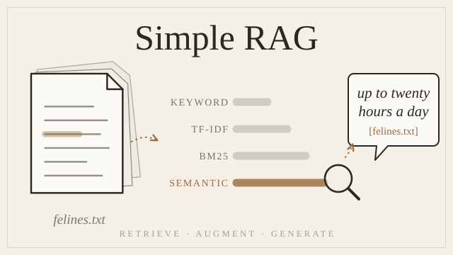

# Simple RAG



Learn how Retrieval-Augmented Generation (RAG) really works by building it yourself in plain Python, one small file at a time.

You'll write **four search engines** (keyword, TF-IDF, BM25 and semantic search), compare them side by side on the same questions, and finish with a RAG app that answers from **your own documents**, cites its sources, and says *"I don't know"* when the answer isn't there.

```
ask> How long can a kitten sleep?
A kitten can sleep up to twenty hours a day. [felines.txt]

ask> Who invented coffee?
I don't know
```

> Without RAG, the same LLM answered "12–16 hours" from its own memory. The practice document says twenty. RAG makes the model answer from *your* data.

---

## What you'll learn

| Method | The idea in one sentence | Fixes |
|---|---|---|
| **Keyword search** | count the question's words in each document | the starting point |
| **TF-IDF** | frequent in this document + rare everywhere else = important | "a" and "is" counting as much as "kitten" |
| **BM25** | TF-IDF where repeating a word stops paying off and long documents get no free advantage | a spam file of "python python python…" winning |
| **Semantic search** | compare *meaning* with embeddings and cosine similarity | "cat" not finding a document about "felines" |
| **RAG** | retrieve the best documents → paste them into the prompt → the LLM answers only from them | the LLM making things up |

Along the way: uv, `.env` config, dataclasses, regex, generators, lambdas, embeddings, tensors, the OpenAI-compatible chat API, and **pytest** (fixtures, `tmp_path`, `approx`, mocking).

**You need:** basic Python (variables, functions, loops, input/output). Every new idea is explained the first time it appears.

---

## Start learning

📘 **[The step-by-step guide →](docs/simple-rag/README.md)**: 12 short steps. Each one has theory, a **before vs. after (measured)** table, a code example, a goal with a checkpoint, tests, and a hidden solution.

📐 **[RAG Concepts →](docs/concepts.md)**: the theory and math behind every method, with real numbers and a one-page cheat sheet.

🗺️ **[Diagrams →](docs/simple-rag/diagrams.md)**: the whole pipeline on one page, showing where each function and model fits.

| # | Step | # | Step |
|---|---|---|---|
| 1 | [Project setup](docs/simple-rag/step-01-project-setup.md) | 7 | [BM25: the formula](docs/simple-rag/step-07-bm25-the-formula.md) |
| 2 | [Loading text files](docs/simple-rag/step-02-loading-text-files.md) | 8 | [BM25: search and compare](docs/simple-rag/step-08-bm25-search-and-compare.md) |
| 3 | [Keyword search: tokenize and score](docs/simple-rag/step-03-keyword-tokenize-and-score.md) | 9 | [Embeddings and similarity](docs/simple-rag/step-09-embeddings-and-similarity.md) |
| 4 | [Keyword search: ranking](docs/simple-rag/step-04-keyword-search.md) | 10 | [Semantic search](docs/simple-rag/step-10-semantic-search.md) |
| 5 | [TF-IDF: the math](docs/simple-rag/step-05-tfidf-the-math.md) | 11 | [Talking to an LLM](docs/simple-rag/step-11-talking-to-an-llm.md) |
| 6 | [TF-IDF: search](docs/simple-rag/step-06-tfidf-search.md) | 12 | [Your first RAG](docs/simple-rag/step-12-your-first-rag.md) |

---

## Setup

The `src/` folder contains the finished project. Set it up to try everything, or start an empty folder and follow the guide from [Step 1](docs/simple-rag/step-01-project-setup.md).

### Requirements
- **[uv](https://docs.astral.sh/uv/)**, the Python package manager. It installs the right Python (3.12) for you.
- **About 1 GB of disk** for PyTorch and the embedding model, and internet on the first run.
- **An LLM provider** for the RAG step only. Any OpenAI-compatible API works, including a free local one (see below). The four search engines need no API key.

### 1. Install uv
Windows (PowerShell):
```powershell
powershell -ExecutionPolicy ByPass -c "irm https://astral.sh/uv/install.ps1 | iex"
```
macOS / Linux:
```bash
curl -LsSf https://astral.sh/uv/install.sh | sh
```

### 2. Get the code and install dependencies
```bash
git clone https://github.com/nettanvirdev/simple_rag.git
cd simple_rag
uv sync
```
`uv sync` creates a private environment in `.venv/` with Python 3.12 and every library from `uv.lock`. Run commands inside it with `uv run …`. You never need to activate it.

### 3. Configure
```bash
cp .env.example .env
```
Then set the three `LLM_*` values in `.env` for your provider:

| Provider | `LLM_BASE_URL` | `LLM_API_KEY` | `LLM_MODEL` (example) |
|---|---|---|---|
| [Ollama](https://ollama.com) (local, free) | `http://localhost:11434/v1` | `ollama` | `llama3.2` |
| [OpenAI](https://platform.openai.com) | `https://api.openai.com/v1` | your key | `gpt-4o-mini` |
| [Groq](https://console.groq.com) | `https://api.groq.com/openai/v1` | your key | `llama-3.1-8b-instant` |
| [OpenRouter](https://openrouter.ai) | `https://openrouter.ai/api/v1` | your key | `meta-llama/llama-3.1-8b-instruct` |

Leave `EMBEDDING_MODEL` as it is. `.env` is git-ignored, so your key never gets committed.

### 4. Run it
Compare all four search methods side by side (no API key needed):
```bash
uv run python -m ragi.retrieval.compare
```
Try `cat`, `is a kitten a good pet`, `python snake`, and `what helps me stay awake`.

Ask questions answered from the files in `data/` (needs step 3):
```bash
uv run python -m ragi.rag
```
Try `How long can a kitten sleep?` and `Who invented coffee?`. Press `Ctrl+C` to quit either one.

You can also run each search method on its own: `uv run python -m ragi.retrieval.keyword` (or `tfidf`, `bm25`, `semantic`).

### 5. Test
```bash
uv run pytest -v
```
Tests never call the real LLM. They use a fake one (see [Step 11](docs/simple-rag/step-11-talking-to-an-llm.md)), so they're free and work offline once the embedding model is downloaded. `tests/test_config.py` checks *your* setup: it expects a filled-in `.env` and a `storage/chroma` folder (`mkdir -p storage/chroma`).

### Troubleshooting
| You see | What it means |
|---|---|
| A warning about **symlinks on Windows** or **HF_TOKEN** | Harmless. It's the model download from Hugging Face; everything still works. |
| The first semantic search or `compare` run is slow | It's downloading and loading the embedding model (~90 MB). Later runs start in a few seconds. |
| `openai.AuthenticationError` or a connection error in `rag` | Check the three `LLM_*` values in `.env`. For Ollama, make sure it's running and the model is pulled (`ollama pull llama3.2`). |

---

## Project structure

```
simple_rag/
├── data/                      practice documents (4 tiny .txt files)
├── docs/
│   ├── concepts.md            theory, math and cheat sheet
│   └── simple-rag/            the 12-step guide
├── src/ragi/
│   ├── config.py              settings, read once from .env
│   ├── loaders.py             files → Document(text, source)
│   ├── retrieval/
│   │   ├── keyword.py         tokenize, score, search
│   │   ├── tfidf.py           tf, idf, score, search
│   │   ├── bm25.py            term_score, score, search
│   │   ├── semantic.py        embed, similarity, search
│   │   └── compare.py         all four methods side by side
│   ├── llm.py                 ask(): any OpenAI-compatible API
│   └── rag.py                 retrieve → augment → generate
└── tests/                     one test file per module + a shared fake LLM
```

Every search method has the same shape, `search(query, docs, k) → [(score, Document), ...]`, so they're interchangeable.

---

## What's next
**[Advanced RAG →](https://github.com/nettanvirdev/advanced_rag)** grows this into a production-shaped pipeline: chunking, a vector database (ChromaDB), hybrid search, reranking, a Redis cache, an evaluation set and a FastAPI server. Every step has a measured before vs. after table.

Both guides are also published at **[nettanvir.dev/docs](https://nettanvir.dev/docs)**.

## License
[Apache License 2.0](LICENSE)
