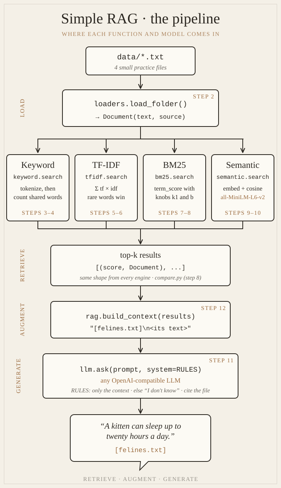
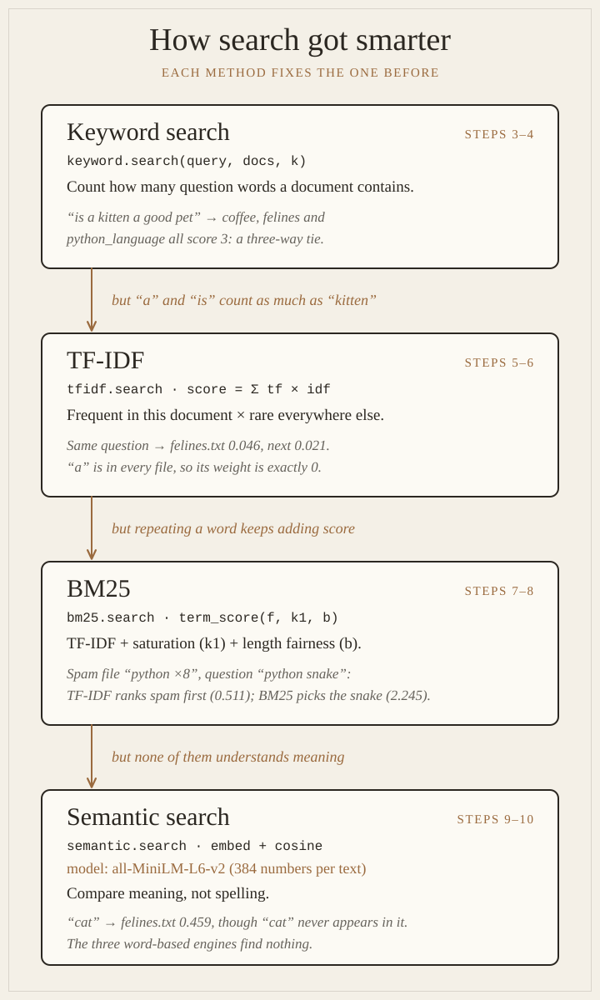

# Diagrams

Two pictures of the whole project. The first shows **where each function and model comes in**, from a text file to a cited answer. The second shows **why there are four search engines**: each one fixes the weakness of the one before.

Use them as a map. When a step feels abstract, find its box here.

---

## 1. The pipeline

| Box | Function | File | Step | What it does |
|---|---|---|---|---|
| data/*.txt | – | `data/` | 2 | Four tiny practice files, each designed to show one search engine winning or failing |
| Load | `load_folder()` | `src/ragi/loaders.py` | [2](step-02-loading-text-files.md) | Reads every `.txt` file into a `Document(text, source)` |
| Keyword | `keyword.search()` | `src/ragi/retrieval/keyword.py` | [3](step-03-keyword-tokenize-and-score.md), [4](step-04-keyword-search.md) | Splits text into words (`tokenize`) and counts the question's words in each document (`score`) |
| TF-IDF | `tfidf.search()` | `src/ragi/retrieval/tfidf.py` | [5](step-05-tfidf-the-math.md), [6](step-06-tfidf-search.md) | Gives each word a weight: frequent here × rare everywhere else |
| BM25 | `bm25.search()` | `src/ragi/retrieval/bm25.py` | [7](step-07-bm25-the-formula.md), [8](step-08-bm25-search-and-compare.md) | TF-IDF plus saturation (`k1`) and length fairness (`b`) |
| Semantic | `semantic.search()` | `src/ragi/retrieval/semantic.py` | [9](step-09-embeddings-and-similarity.md), [10](step-10-semantic-search.md) | Turns text into 384 numbers with the **all-MiniLM-L6-v2** model and compares directions (cosine similarity) |
| Compare | `compare.py` | `src/ragi/retrieval/compare.py` | [8](step-08-bm25-search-and-compare.md) | Runs all four side by side for the same question |
| top-k | `[(score, Document), ...]` | – | 4 | Every engine returns the same shape, so they're interchangeable |
| Augment | `build_context()` | `src/ragi/rag.py` | [12](step-12-your-first-rag.md) | Labels each document with its file name: `[felines.txt]` + its text |
| Generate | `ask(prompt, system=RULES)` | `src/ragi/llm.py` | [11](step-11-talking-to-an-llm.md) | Sends the context and the rules to **any OpenAI-compatible LLM** |
| Answer | `answer()` | `src/ragi/rag.py` | [12](step-12-your-first-rag.md) | Retrieve → augment → generate: an answer that cites its file, or "I don't know" |

The three words at the bottom, **retrieve · augment · generate**, are what the letters R, A and G in RAG stand for.

---

## 2. How search got smarter

| Engine | Fixes | Real example from the practice files |
|---|---|---|
| Keyword | (the starting point) | "is a kitten a good pet": three files tie at 3 because they all contain "is" and "a" |
| TF-IDF | filler words counting as much as rare ones | the same question: felines.txt 0.046, next 0.021, because "a" is in every file, so its weight is 0 |
| BM25 | repeating a word to win | a spam file of "python" ×8: TF-IDF ranks it first (0.511), BM25 ranks python_snake.txt first (2.245) |
| Semantic | no understanding of meaning | "cat" finds felines.txt (0.459), though the word "cat" isn't in it; the other three find nothing |

The theory and math behind every box are in [RAG Concepts](../concepts.md).

---

**Back to:** [Simple RAG overview](README.md) · **Start:** [Step 1: Project setup →](step-01-project-setup.md)
